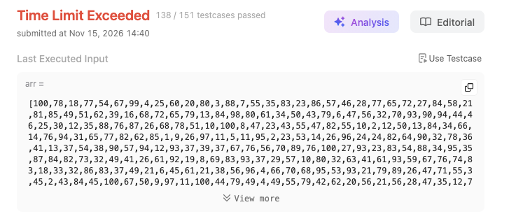
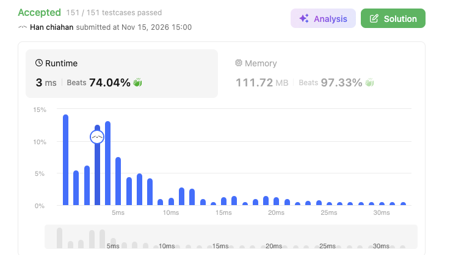

## Description

Given an array of integers arr, return the number of subarrays with an odd sum.

Since the answer can be very large, return it modulo `10^9 + 7`.

 
Example 1:

Input: arr = `[1,3,5]`
Output: `4`
Explanation: All subarrays are `[[1],[1,3],[1,3,5],[3],[3,5],[5]]`
All sub-arrays sum are `[1,4,9,3,8,5]`.
Odd sums are `[1,9,3,5]` so the answer is `4`.

Constraints:
- `1 <= arr.length <= 105`
- `1 <= arr[i] <= 100`

## Solutoins

### Approach 1 - Brute Force

直接計算所有的 subarray 然後檢查 subarray sum 是否為 odd

```cpp
class Solution {
public:
    int numOfSubarrays(vector<int>& arr) {
        long long MOD = 1e9 + 7;
        int n = arr.size();
        long long ans = 0;
        for (int i = 0; i < n; i++) {
            long long sum = 0;
            for (int j = i; j < n; j++) {
                sum = (sum + arr[j]) % MOD;
                if (sum % 2 == 1) ans += 1;
            }
        }

        return ans;
    }
};
```

但是 `arr.length` 最大會到 `10^5` 最多要跑大約 `5 * 10^9` 次 -> 會 TLE


- Time Complexity : `O(n^2)`
- Space Complexity : `O(1)`

### Approach 2 - Prefix sum

Key observation:
- 讓 `prefix[i]` 為前 `i` 個元素的和 (`prefix[0] = 0`) 那 subarray `arr[i..j]` 的和就是 `prefix[j + 1] - prefix[i]`
- **當兩數相減為奇數 <=> 兩數的奇偶性不同**
- 所以題目就可以變成 : 有幾對 `(i, j)` 的前綴和一奇一偶?
- 用 `prefix` 紀錄目前的前綴和, `even` 紀錄目前的偶數前綴和的數量, `odd` 紀錄奇數前綴和的數量
    - 如果新的 `preifx` 是奇數 -> 和之前的每個偶數前綴和配對, `ans += even`
    - 如果新的 `preifx` 是偶數 -> 和之前的每個奇數前綴和配對, `ans += odd`

```cpp
class Solution {
public:
    int numOfSubarrays(vector<int>& arr) {
        int n = arr.size();
        long long MOD = 1e9 + 7;
        long long ans = 0;
        long long even = 1, odd = 0, prefix = 0;

        for (int x : arr) {
            prefix = (prefix + x) & 1;
            if (prefix) {
                ans += even;
                odd++;
            } else {
                ans += odd;
                even++;
            }
        }

        return ans % MOD;
    }
};
```

- 成功 AC



- Time Complexity : `O(n)`
- Space Complexity : `O(1)`
